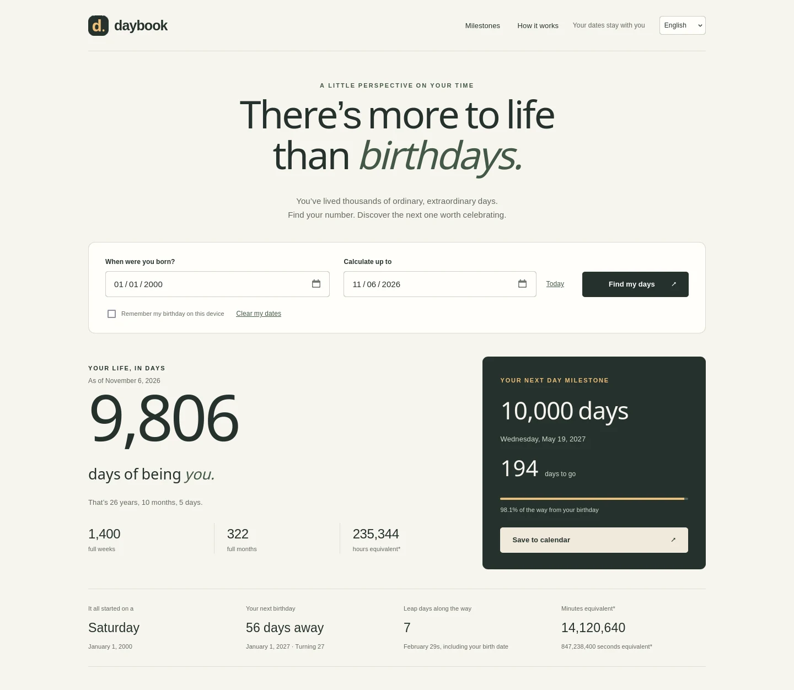

# Daybook

ブラウザだけで動く、誕生日と「日のマイルストーン」の計算ツールです。生まれてから何日たったか、10,000日目がいつか、誕生日の間に訪れる祝うべき日を見つけられます。

**ライブデモ：** https://wici-kt.github.io/daybook/

[English](README.md) | [繁體中文](README.zh-TW.md) | 日本語 | [한국어](README.ko.md)



## できること

誕生日と計算したい日付を入れると、Daybook は生きてきた日数、年・か月・日で表した年齢、生まれた曜日、次の誕生日、これまでのうるう日、そしていまの1年の1日ごとの点を表示します。下の表には、日のマイルストーンとその日付、その日の年齢、計算日からの差が並びます。

1 から 1,000,000 までの好きな日数を追加でき、2通りの数え方を切り替え、表を絞り込み、すべてのマイルストーンを CSV でダウンロードし、次のマイルストーンを終日カレンダーの予定として保存できます。

## 機能

- 暦の日数、年・か月・日で表した年齢、まる1週間とまる1か月、さらに時間・分・秒の換算。
- 100日・1,000日・10,000日を含む29個のプリセットと、1 から 1,000,000 までのカスタム日数。
- 数え方は2通り：誕生日を0日目（標準）とするか、1日目とするか。
- すべてのマイルストーンの CSV 出力と、次のマイルストーンの `.ics` ファイル。
- 英語・繁體中文・日本語・한국어 の画面。選んだ言語は端末に記憶されます。
- レスポンシブなレイアウト、キーボード操作、スクリーンリーダー用ラベル、動きを減らす設定と印刷用スタイル。

## クイックスタート

インストールもビルドもアカウントも不要です。

- ライブサイトを開く：https://wici-kt.github.io/daybook/
- または、このフォルダの `index.html` をブラウザで開く。
- または、フォルダ内で `python3 -m http.server 8080` を実行し、`http://localhost:8080` を開く。

## GitHub Pages で公開する

1. GitHub にサインインし、`daybook` という名前の**公開**リポジトリを作成します。
2. **Add file → Upload files** を選び、`index.html`、`style.css`、`calc.js`、`i18n.js`、`exporters.js`、`app.js` をリポジトリ直下にアップロードします。ファイル選択画面で隠しファイルが表示される場合は `.nojekyll` も含めてください。`main` にコミットします。
3. **Settings → Pages** を開きます。
4. **Build and deployment** で **Deploy from a branch** を選びます。
5. ブランチ **main**、フォルダ **/(root)** を選び、**Save** を押します。
6. デプロイが終わるまで待ちます。Pages の設定にサイトの URL（通常は `https://YOUR-USERNAME.github.io/daybook/`）が表示されます。

`https://YOUR-USERNAME.github.io/`（プロジェクトのパスなし）で公開する場合は、リポジトリ名を `YOUR-USERNAME.github.io` にしてください。

アップロードするのは ZIP ファイルや入れ子の `daybook` フォルダではなく、ファイルそのものです。アセットのパスはすべて相対なので、リポジトリの URL でもルートの URL でも動きます。

公式の手順：https://docs.github.com/en/pages/getting-started-with-github-pages/configuring-a-publishing-source-for-your-github-pages-site

## 日数の数え方

日付は先発グレゴリオ暦を使います。計算日は誕生日以降である必要があり、入力できるのは0001年から9998年までです。

「生きてきた日数」は常に経過した暦日数です。「誕生日 = 1日目」はマイルストーンの日付だけを変えます。標準の100日マイルストーンは誕生日から100日後、1日目として数えると100日目は誕生日から99日後になります。

日付計算は夏時間の影響を避けるため UTC の日番号で行い、「今日」は端末の現地の暦から取得します。時間の換算は暦日数をもとにした値（1日24時間、1時間60分、1分60秒）で、現在時刻や出生時刻からの実経過時間ではありません。

2月29日生まれの人の誕生日は、うるう年でない年には2月28日になります。まる1か月は元の誕生日から数え、その月の末日に丸めます。うるう日は両端を含めて数えます。

## プライバシー

計算はすべて端末の中で行われます。アクセス解析、外部フォント、アカウント、バックエンドはありません。「この端末に誕生日を記憶する」を選んだときだけ、誕生日がこのブラウザに保存されます。「日付を消去」で削除できます。言語の設定は別に保存されます。カレンダーと CSV のダウンロードには記念日の日付が含まれるので、共有にはご注意ください。

## 開発

Node.js で2つのチェックを実行します。インストールするパッケージはありません。

```sh
node tests.cjs
node tests-i18n.cjs
```

`tests.cjs` は日付計算（うるう年、月末の丸め、0日目と1日目のマイルストーン、不正な入力の拒否）を確認します。`tests-i18n.cjs` は4言語の辞書の対応、プレースホルダーの一致、未翻訳の文字列、日付と数値の書式、言語の決定順、CSV とカレンダーの出力を確認します。

サイトは4本のスクリプトと1枚のスタイルシートで、ビルドはありません：`calc.js`（日付計算）、`i18n.js`（文言と書式）、`exporters.js`（CSV／ICS）、`app.js`（画面の制御）。
