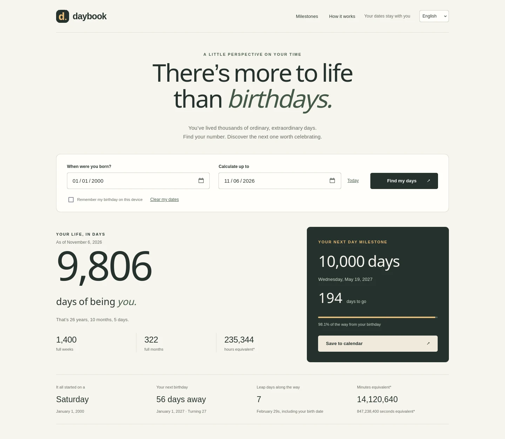

# Daybook

브라우저 안에서만 동작하는 생일·날 마일스톤 계산기입니다. 태어난 뒤 며칠을 살았는지, 10,000일째가 언제인지, 생일 사이에서 축하할 만한 날이 언제인지 알려줍니다.

**라이브 데모:** https://wici-kt.github.io/daybook/

[English](README.md) | [繁體中文](README.zh-TW.md) | [日本語](README.ja.md) | 한국어

## 무엇을 하는 도구인가요

생일과 계산 기준일을 입력하면 Daybook은 살아온 날수, 년·개월·일로 나타낸 나이, 태어난 요일, 다음 생일, 지나온 윤일, 그리고 지금의 한 해를 하루에 점 하나로 보여줍니다. 아래 표에는 날 마일스톤과 그 날짜, 그날의 나이, 계산일로부터의 차이가 정리됩니다.

1부터 1,000,000까지 원하는 날수를 추가하고, 두 가지 세는 방식을 바꾸고, 표를 걸러 보고, 모든 마일스톤을 CSV로 내려받고, 다음 마일스톤을 종일 캘린더 일정으로 저장할 수 있습니다.

## 기능

- 살아온 날, 다음 마일스톤과 남은 일수를 담은 공유 이미지를 네 가지 언어로 다운로드.
- 달력 날수, 년·개월·일로 나타낸 나이, 온전한 주와 달, 그리고 시간·분·초 환산.
- 100일·1,000일·10,000일을 포함한 29개의 기본 마일스톤과 1부터 1,000,000까지 직접 추가하는 마일스톤.
- 두 가지 세는 방식: 출생일을 0일째(기본)로 보거나 1일째로 보기.
- 모든 마일스톤의 CSV 내보내기와 다음 마일스톤의 `.ics` 파일.
- 영어·繁體中文·日本語·한국어 화면. 고른 언어는 기기에 기억됩니다.
- 반응형 레이아웃, 키보드 조작, 스크린 리더 레이블, 동작 줄이기 설정과 인쇄 스타일.

## 빠른 시작

설치도, 빌드도, 계정도 필요 없습니다.

- 라이브 사이트 열기: https://wici-kt.github.io/daybook/
- 또는 이 폴더의 `index.html`을 브라우저에서 열기.
- 또는 폴더에서 `python3 -m http.server 8080`을 실행한 뒤 `http://localhost:8080` 열기.
