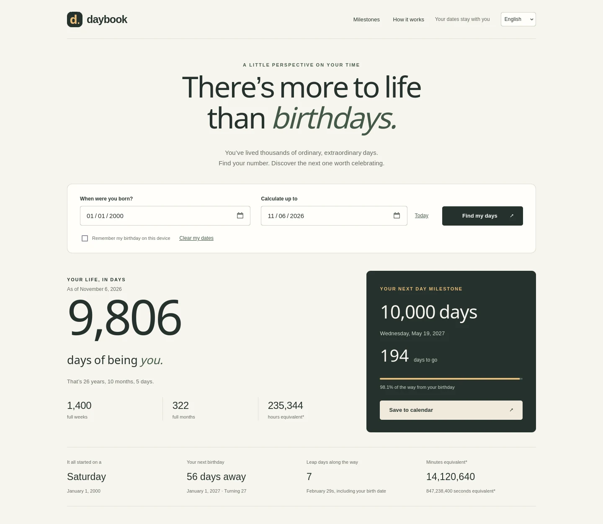

# Daybook

A birthday and day-milestone calculator that runs entirely in the browser. See how many days you have lived, when your 10,000th day falls, and which days between birthdays are worth celebrating.

**Live demo:** https://wici-kt.github.io/daybook/

English | [繁體中文](README.zh-TW.md) | [日本語](README.ja.md) | [한국어](README.ko.md)



## What it does

Enter a birthday and a date to calculate against. Daybook shows the days lived, your age in years, months and days, the weekday you were born, your next birthday, leap days along the way, and one dot for every day of your current year of life. The table below lists day milestones with their calendar dates, your age on each date, and how far away each one is.

Add any day number from 1 to 1,000,000, switch between two counting conventions, filter the table, download every milestone as CSV, and save the next milestone as an all-day calendar event.

## Features

- Calendar days lived, age in years/months/days, full weeks and full months, plus hour, minute and second equivalents.
- 29 preset milestones including 100, 1,000 and 10,000 days, plus custom milestones up to 1,000,000.
- Two counting conventions: birth as day 0 (default) or birth as day 1.
- CSV export of all milestones and an `.ics` file for the next one.
- English, Traditional Chinese, Japanese and Korean interface; the choice is remembered on the device.
- Responsive layout, keyboard controls, screen reader labels, reduced-motion and print styles.

## Quick start

No installation, build step or account is needed.

- Open the live site: https://wici-kt.github.io/daybook/
- Or open `index.html` from this folder in a browser.
- Or serve the folder locally: `python3 -m http.server 8080`, then open `http://localhost:8080`.

## Publish on GitHub Pages

1. Sign in to GitHub and create a new **public** repository named `daybook`.
2. Choose **Add file → Upload files**. Upload `index.html`, `style.css`, `calc.js`, `i18n.js`, `exporters.js` and `app.js` into the repository root. Include `.nojekyll` if your file picker shows hidden files. Commit to `main`.
3. Open **Settings → Pages**.
4. Under **Build and deployment**, choose **Deploy from a branch**.
5. Select branch **main**, folder **/(root)**, and click **Save**.
6. Wait for deployment. The Pages settings will show your website address, normally `https://YOUR-USERNAME.github.io/daybook/`.

For `https://YOUR-USERNAME.github.io/` without a project path, name the repository `YOUR-USERNAME.github.io` instead.

Upload the files themselves, not a ZIP file or a nested `daybook` folder. All asset paths are relative, so both repository URLs and root URLs work.

Official instructions: https://docs.github.com/en/pages/getting-started-with-github-pages/configuring-a-publishing-source-for-your-github-pages-site

## How days are counted

Dates use the proleptic Gregorian calendar. The calculation date must be on or after birth; inputs support years 0001–9998.

The days-lived total always measures elapsed calendar days. “Birth = day 1” changes milestone dates only: the default 100-day milestone is birth plus 100 days, while day 1 counting puts the 100th day at birth plus 99 days.

Date arithmetic uses UTC day indices to avoid daylight saving errors; today's date comes from the device's local calendar. Time equivalents are date-based (24 hours per calendar day, 60 minutes per hour, 60 seconds per minute), not a live clock or a measurement from an exact birth time.

February 29 anniversaries fall on February 28 in non-leap years. Full months are counted from the original birth date with month-end clamping. Leap days include both endpoints.

## Privacy

Every calculation runs on your device. There are no analytics, external fonts, accounts or backend. The birthday is stored in the browser only when you select “Remember my birthday”; “Clear my dates” removes it. The language preference is stored separately. Calendar and CSV downloads contain your milestone dates, so share them thoughtfully.

## Development

Run both check suites with Node.js; there are no packages to install.

```sh
node tests.cjs
node tests-i18n.cjs
```

`tests.cjs` covers the date arithmetic: leap years, month-end clamping, day 0 vs day 1 milestones, and rejected inputs. `tests-i18n.cjs` checks dictionary parity across the four locales, placeholder consistency, untranslated strings, localized date and number formats, the language-resolution order, and the CSV and calendar output.

The site is four scripts and one stylesheet with no build step: `calc.js` (date math), `i18n.js` (strings and formatting), `exporters.js` (CSV/ICS), `app.js` (interface wiring).
