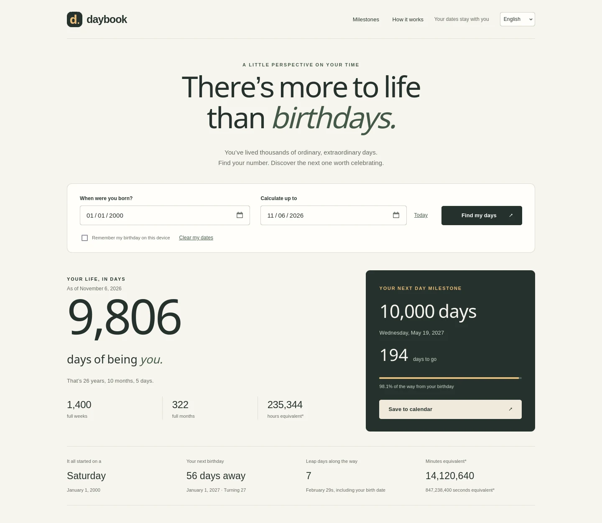

# Daybook

一個完全在瀏覽器裡運作的生日與日子里程碑計算器。算出你活了幾天、第 10,000 天是哪一天，以及兩個生日之間值得慶祝的日子。

**線上示範：** https://wici-kt.github.io/daybook/

[English](README.md) | 繁體中文 | [日本語](README.ja.md) | [한국어](README.ko.md)

## 這個工具做什麼

輸入生日和要計算的日期，Daybook 會顯示活了幾天、以年／月／天表示的年齡、出生當天是星期幾、下一個生日、途中經過的閏日，以及你目前這一歲每一天的一個點。下方的表格列出各個日子里程碑、對應日期、當天年齡，以及距離計算日期還有多遠。

你可以加入 1 到 1,000,000 之間的任何天數、切換兩種計算方式、篩選表格、把所有里程碑下載成 CSV，並把下一個里程碑存成全天行事曆事件。

## 功能

- 下載分享圖片，顯示已活天數、下一個里程碑與倒數，支援四種語言。
- 日曆天數、年齡（年／月／天）、整週與整月，以及小時、分鐘、秒的換算。
- 29 個預設里程碑（包含 100、1,000、10,000 天），可自訂 1 到 1,000,000 天。
- 兩種計算方式：出生當天為第 0 天（預設）或第 1 天。
- 將所有里程碑匯出為 CSV，並把下一個里程碑存成 `.ics` 行事曆檔。
- 英文、繁體中文、日文、韓文介面，語言選擇會記在這部裝置上。
- 響應式版面、鍵盤操作、螢幕報讀標籤、減少動態效果與列印樣式。

## 快速開始

不需要安裝、建置或帳號。

- 直接開啟線上網站：https://wici-kt.github.io/daybook/
- 或用瀏覽器開啟這個資料夾裡的 `index.html`。
- 或在本機啟動：`python3 -m http.server 8080`，再開啟 `http://localhost:8080`。
